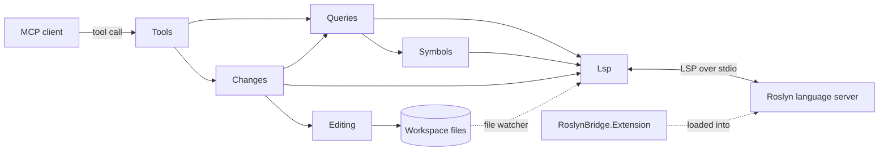

# Architecture

Roslyn Bridge MCP is a .NET tool that serves C# tools over the Model Context Protocol (MCP). It starts the official Roslyn language server, keeps it in sync with the workspace files and turns tool calls into Language Server Protocol (LSP) requests.

## Design rules

- The bridge must be standalone and usable from any MCP client.
- The tools use the official [MCP SDK](https://csharp.sdk.modelcontextprotocol.io/), and the Roslyn connection uses [StreamJsonRpc](https://microsoft.github.io/vs-streamjsonrpc/).
- Standard output is reserved for MCP messages. Logs go to standard error.
- The bridge runs in invariant globalization mode, so behavior does not depend on the machine's culture.
- A Roslyn change is applied only when each file still matches the version used to compute it.

## A tool call

- One tool call runs at a time. `bulk_navigate` runs its queries concurrently inside its call.
- Before a request, the session sends Roslyn the files that changed on disk since the last one.
- An edit is computed against a snapshot of the workspace. The bridge refuses it when a file it touches or a project file changed since.

## Roslyn extension

`src/RoslynBridge.Extension` runs inside the Roslyn process and calls internal Roslyn members through reflection. It answers `references`, `reads` and `writes` without the 500 ms batching delay of the LSP handler, `callers` through interface and base members, and `symbols` with `unused`, which LSP cannot answer.

When it fails, the bridge logs a warning and uses the LSP requests until the next session. `unused` has no fallback and returns `lsp_error`.

`RoslynServerVersion` in `Directory.Packages.props` sets the server that `setup` installs, that the CI tests against and that the extension compiles against. A new version must pass `mise run test-integration` on every platform the CI covers, since Roslyn changes its path handling between versions.
