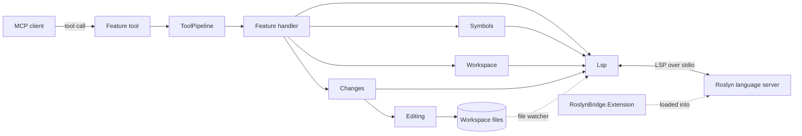

# Architecture

Roslyn Bridge MCP is a .NET tool that serves C# tools over the Model Context Protocol (MCP). It starts the official Roslyn language server, keeps it in sync with the workspace files and turns tool calls into Language Server Protocol (LSP) requests.

## Design rules

- The bridge must be standalone and usable from any MCP client.
- The tools use the official [MCP SDK](https://csharp.sdk.modelcontextprotocol.io/), and the Roslyn connection uses [StreamJsonRpc](https://microsoft.github.io/vs-streamjsonrpc/).
- Standard output is reserved for MCP messages. Logs go to standard error.
- The bridge runs in invariant globalization mode, so behavior does not depend on the machine's culture.
- A Roslyn change is applied only when each file still matches the version used to compute it.

## A tool call

## Layout

- `Features` has one folder per tool, with its tool class, requests, handlers and results.
- `Common` has the pipeline that every call goes through: validation, the gate, the timeout, file resolution and the response.
- `Symbols`, `Workspace`, `Changes` and `Editing` contain the code that several features share.
- `Lsp` runs Roslyn and its session. `Lsp/Protocol` contains the LSP records and the parsing of answers.
- `Hosting` contains the entry point and the `setup` command.

## Rules

- A shared folder never depends on a feature, and the shared folders form no cycle.
- A tool never uses another tool. `bulk_navigate` calls the handler of `navigate`.
- Only the raw `request` action of `lsp` handles JSON. The other code uses the typed methods of `RoslynSession`.
- An expected failure is a `Result` with a `ToolError`. Any other exception is a bug, except a cancellation.

## Calls and edits

- One tool call runs at a time. Before a request, the session sends Roslyn the files that changed on disk.
- An edit is computed against a snapshot of the workspace. The bridge refuses it when a file it touches or a project file changed since.
- A failure after a write makes Roslyn reload the workspace from disk.
- A proposal belongs to one Roslyn process. A reload or a restart makes it unknown.

## Roslyn extension

`src/RoslynBridge.Extension` runs inside the Roslyn process and calls internal Roslyn members through reflection. It answers `references`, `reads` and `writes` without the 500 ms batching delay of the LSP handler, `callers` through interface and base members, `expression` with the compiler facts at a position, and `symbols` with `unused`. LSP cannot answer the last two.

When a handler fails, the bridge logs a warning and disables only that handler until the next session. `references`, `reads`, `writes` and `callers` then use the LSP requests. `unused` and `expression` have no fallback and return `lsp_error`.

`RoslynServerVersion` in `Directory.Packages.props` sets the server that `setup` installs, that the CI tests against and that the extension compiles against. A new version must pass `mise run test-integration` on every platform the CI covers, since Roslyn changes its path handling between versions.
